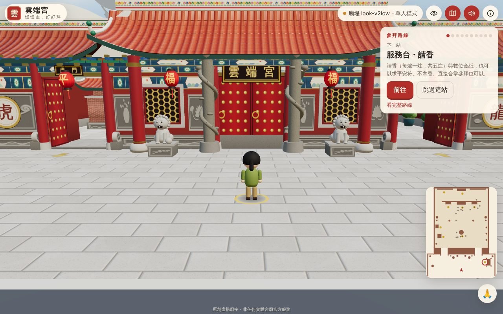
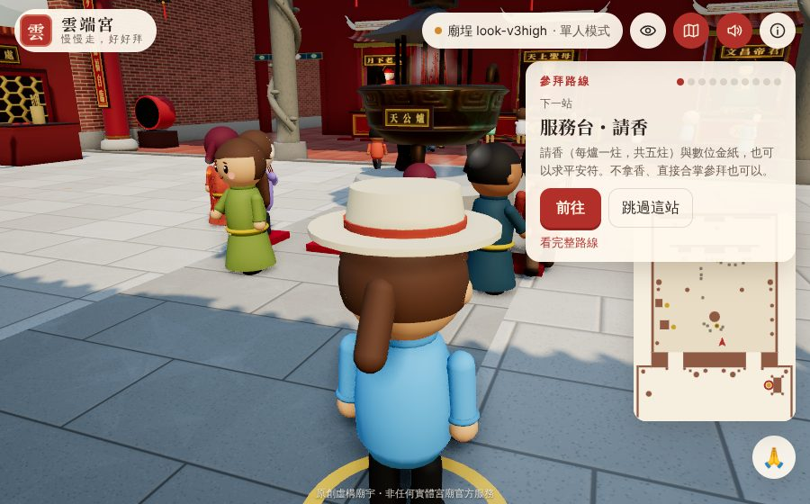
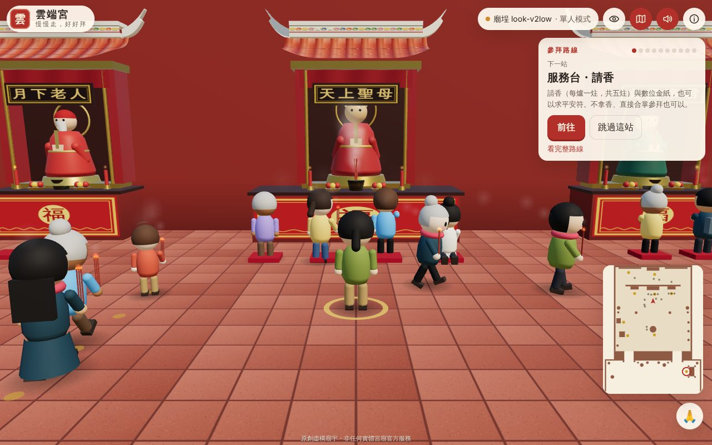
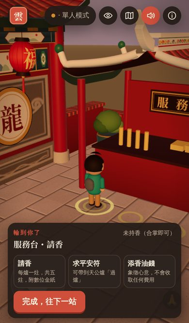
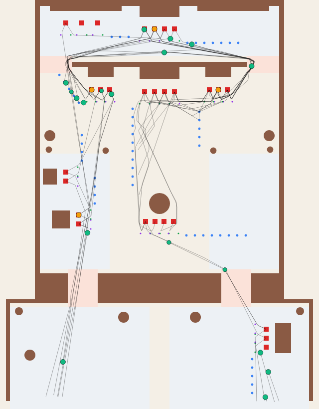
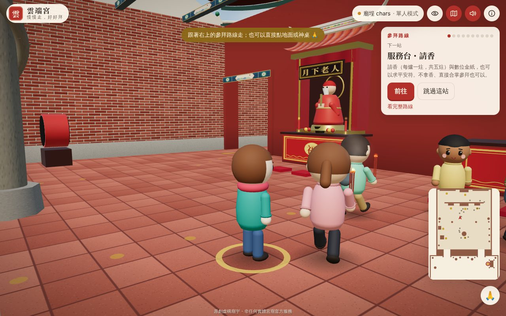

# 雲端宮・線上參拜

一座**原創、虛構**的 3D 線上廟宇。照著傳統動線慢慢走：龍門進、虎門出；拜墊一人一個，人多會自動排隊，大家不會撞在一起。支援多人同廟埕（`?room=court-1`），連不上伺服器時自動改成單人模式。



| 中庭（高畫質） | 正殿 | 手機（深色） |
| --- | --- | --- |
|  |  |  |

## 這一版改善的重點

### 1. 人物不會互相撞到

每個人（電腦香客、你、其他真人）移動時都經過四層處理：

1. **路徑規劃**：A* 尋路，避開牆角、不穿過神桌前方，也不會從別人的拜墊中間穿過。
2. **預判避讓（ORCA）**：預測 1～2 秒內會不會撞到人，提前選一個安全、又最接近原方向的速度。
3. **繞行與禮讓**：前方有人站著就先側身繞過；迎面有人就靠右；被擠住太久會退半步讓路（解決 ORCA 在完全對稱時會僵住的已知問題）。
4. **硬性不重疊**：最後一道保護，身體之間至少保留 1.5 公分。人物模型最寬處小於碰撞半徑，所以模型也不會穿插。

模擬報告（`npm run report`，10 分鐘模擬時間）：

| 人數 | 完成參拜 | 最近距離 | 重疊 | 穿牆 | 卡住被移除 |
| --- | --- | --- | --- | --- | --- |
| 18 | 55 人次 | 1.9 cm | 0 | 0 | 0 |
| 34 | 102 人次 | 6.5 cm | 0 | 0 | 0 |

### 2. 動線更順暢



- **單向環狀動線**：右下進場 → 服務台 → 龍門 → 天公爐 → 正殿 → 龍邊 → 東側門進後殿（由東往西）→ 西側門 → 虎邊 → 求籤／金爐 → 虎門 → 左下離開。整圈沒有逆流、沒有交叉。上圖黑線是實際模擬出來的軌跡。
- **拜墊與排隊**：拜墊一人一個；滿了就站在地上的金色小點排隊，前面的人離開時整排往前移。走進拜墊從後方上去、離開往下游走，不會在別人前面穿梭。
- **自動帶路**：按「前往」就會自己走到下一站排隊；完成一站後自動帶到下一站，隨時可以用搖桿或方向鍵接手。
- **鏡頭**：第三人稱跟隨、拖曳旋轉、滾輪或雙指縮放；靠牆時自動拉近，不會穿牆或穿天花板；也可切換俯瞰全景。

### 3. 多人連線也順

- 你自己的角色在瀏覽器裡即時計算，按下就動，沒有網路延遲。
- 其他人的位置用「快照插值」平滑播放，網路抖動也不會瞬移。
- 慢的裝置會把一幀拆成小步計算，走路速度不會變成慢動作。

### 4. 美術與光影

- **寺廟工藝細節**：一片片筒瓦與瓦當、椽子、封簷板、垂脊；剪黏花帶屋脊、分叉上翹的燕尾、寶塔脊飾與雙龍；三川殿的石雕牆堵、六角窗、彩繪樑枋、斗拱、盤龍石柱、抱鼓石；塔式金爐、服務台棚架、中庭燈籠串。全部由程式產生，沒有外部模型或圖檔。
- **材質**：花崗岩、磚牆、青銅浮雕都有法線貼圖（凹凸感），牆面底部烘焙陰影，讓建物「坐」在地上。
- **光影**：環境光依時段變化，金箔、青銅、琉璃瓦會反光；電腦版另有環境遮蔽、柔和泛光與色調校正，裝置吃力時會自動逐步關閉。
- **人物**：眼睛高光、眉毛、微笑、耳朵、瀏海、衣領、袖口、鈕扣、圓頭鞋。



### 5. 其他

- 拜拜流程：請香、拜天公、合掌參拜、跪拜、插香、平安符過爐、點光明燈（同廟埕的人都看得到燈亮）、擲筊問事、求籤（先擲筊請示 → 抽籤 → 擲筊確認）、化金紙。
- 30 首**原創籤詩**，直書呈現。
- 依你的當地時間切換白天／黃昏／夜晚（夜晚燈籠會亮），介面也有淺色與深色兩套配色。
- 手機版面、搖桿、大按鈕；省電畫質會自動啟用。
- 聲音全部用 WebAudio 即時合成，沒有外部音檔。
- **隱私**：免註冊。稟告內容只留在你的分頁，不會上傳或保存；暱稱只顯示給同廟埕的人。

## 在自己電腦上跑

需要 Node.js 18.17 以上。

```bash
npm install
```

```bash
npm start
```

打開 <http://localhost:3000/?room=court-1>。同一個 `room` 的人會在同一個廟埕。

- 單人模式：`?offline=1`
- 指定畫質：`?quality=high` 或 `?quality=low`

## 部署到 Render

repo 裡附了 `render.yaml`（Render Blueprint）：在 Render 選 **New → Blueprint**，指向這個 repo 即可。也可以手動建立 Web Service：

- Build Command：`npm ci`
- Start Command：`npm start`
- Health Check Path：`/healthz`

免費方案閒置一段時間會休眠，第一次打開需要等它喚醒。

只想放靜態網站（例如 GitHub Pages，沒有多人連線，會自動用單人模式）：

```bash
npm run build:static
```

把產生的 `dist/` 上傳即可。

## 測試

```bash
npm test
```

20 項測試，涵蓋：路徑走龍門進、虎門出；拜墊與排隊的規則；10 分鐘高密度人流零重疊、零穿牆；真人站在通道上時電腦香客會繞開；ORCA 的對向、八人對穿圓心；伺服器路由、路徑穿越防護、兩人同房同步、壞資料與超大訊息。

```bash
npm run report -- 600 34 --svg tools/out/flow.svg
```

輸出人流統計，並畫出軌跡圖。

## 專案結構

```text
server.js                靜態檔 + WebSocket 房間（每房 30 Hz 模擬，15 Hz 廣播）
public/js/sim/           伺服器與瀏覽器共用的模擬
  world.js               寺廟格局、各站拜墊與排隊點、單向區域
  nav.js                 導航網格與 A*（含逆向成本、離牆成本）
  orca.js                ORCA 避讓求解器
  mover.js               路徑跟隨、繞行轉向、硬性不重疊
  stations.js            拜墊分配與排隊
  room.js                一個廟埕：電腦香客、真人玩家、事件
  ritual.js              動作、劇本、外觀
public/js/render/        Three.js 場景、寺廟建模、人物、特效、鏡頭、後製
lib/vendor.js            讓 three.js 附加模組不需 import map 就能載入
public/js/client/        連線（線上／單人）、自己的角色、輸入
public/js/ui/            介面、擲筊求籤、籤詩、音效
test/                    自動化測試
tools/                   模擬報告、靜態網站打包
```

## 內容說明

- 雲端宮是虛構廟宇，神明配置（天上聖母、文昌帝君、月下老人、觀世音菩薩）為常見組合的示意，不代表任何實體宮廟；本站與任何宮廟無關。
- 參拜順序、龍邊虎邊、擲筊與求籤步驟參考民間常見說法，各廟做法不同，實際參拜請依各廟指示。參考資料：
  - [拜拜宜忌與插香（TVBS 健康 2.0）](https://health.tvbs.com.tw/nutrition/331497)
  - [入廟參拜禮儀（遠見雜誌）](https://www.gvm.com.tw/article/54848)
  - [拜拜求籤步驟（UPtoGO）](https://uptogo.com.tw/%e6%96%87%e5%8c%96/%e5%ae%97%e6%95%99/%e6%8b%9c%e6%8b%9c%e6%b1%82%e7%b1%a4%e6%ad%a5%e9%a9%9f%ef%bc%9f/)
- 籤詩為本站原創，非任何廟宇的傳統籤詩，僅供參考與娛樂。
- 「添香油錢」只是象徵，不會收取任何費用。

## 授權與第三方

- [three.js](https://threejs.org/)（MIT）
- [ws](https://github.com/websockets/ws)（MIT）
- [Noto Serif TC](https://fonts.google.com/noto/specimen/Noto+Serif+TC)（SIL Open Font License，經 Google Fonts 載入，用於匾額與標題）
